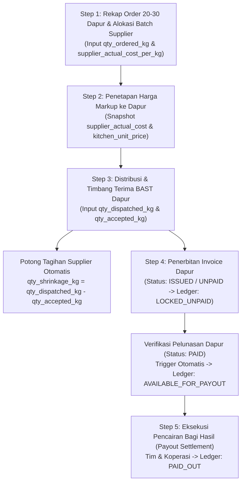

# 01 — Alur Kerja Operasional Harian, Rumus Kalkulasi, & Simulasi Bagi Hasil

Dokumen ini mendefinisikan siklus operasional harian untuk menyuplai bahan baku ke **20–30 Dapur Makan Bergizi Gratis (MBG / SPPG)**, rumus finansial presisi tinggi, serta simulasi angka nyata dari hulu (Batch Supplier) hingga hilir (Pencairan Bagi Hasil Tim & Koperasi).

---

## Diagram Alur Operasional Harian (End-to-End)

---

## Step 1: Rekap Order Dapur & Alokasi Batch Supplier

Setiap hari (H-1 sore atau H-0 dini hari), tim mengumpulkan kebutuhan bahan baku dari **20–30 Dapur MBG** dalam satuan dasar **kilogram (`kg`, `NUMERIC(10,3)`)**.

1. **Agregasi Kebutuhan Dapur:**
   - Misal: 25 dapur memesan *Dada Ayam Fillet* dengan total kebutuhan `625.000 kg`.
2. **Pembuatan Batch Pengadaan Supplier (`supplier_procurement_batches`):**
   - Karena satu supplier belum tentu sanggup memenuhi seluruh kebutuhan 25 dapur, pengadaan dapat dipecah ke beberapa supplier (atau beberapa batch dari supplier yang sama dengan harga berbeda).
   - Setiap batch mencatat:
     - `batch_code`: Kode unik batch (misal: `BATCH-20261016-SUP01-AYM`).
     - `supplier_id`: ID Supplier asal barang.
     - `item_id`: ID bahan baku.
     - `qty_procured_kg`: Total bobot yang dikirim oleh supplier (`NUMERIC(10,3)`).
     - `supplier_actual_cost_per_kg`: Harga beli aktual per kg dari supplier untuk batch tersebut (`NUMERIC(15,2)`).
3. **Alokasi Batch ke Dapur:**
   - Setiap pengiriman ke dapur (`kitchen_delivery_items`) wajib menunjuk `supplier_batch_id` secara eksplisit (**Invariant 3: Actual Supplier Batch Costing**).

---

## Step 2: Penetapan Harga Markup ke Dapur

Sebelum atau saat surat jalan diterbitkan, role `OWNER_ADMIN` / `FINANCE` menetapkan harga jual ke masing-masing dapur (`kitchen_unit_price_per_kg`) di atas `supplier_actual_cost_per_kg`.

### Mode Perhitungan Markup
Sistem mendukung dua metode konfigurasi markup yang menghasilkan `kitchen_unit_price_snapshot` (`NUMERIC(15,2)`):

1. **Markup Nominal Tetap (`FIXED_PER_KG`):**
   $$\text{kitchen\_unit\_price\_snapshot} = \text{supplier\_actual\_cost\_snapshot} + \text{markup\_nominal\_per\_kg}$$
2. **Markup Persentase (`PERCENTAGE`):**
   $$\text{kitchen\_unit\_price\_snapshot} = \text{ROUND}\left(\text{supplier\_actual\_cost\_snapshot} \times \left(1 + \frac{\text{markup\_pct}}{100}\right), 2\right)$$

> [!IMPORTANT]
> **Aturan Validasi & Immutability:**
> - Sistem wajib menolak transaksi apabila `kitchen_unit_price_snapshot < supplier_actual_cost_snapshot` (mencegah margin negatif tanpa otorisasi).
> - Begitu dialokasikan ke `kitchen_delivery_items`, baik `supplier_actual_cost_snapshot` maupun `kitchen_unit_price_snapshot` dikunci secara permanen di baris transaksi tersebut.

---

## Step 3: Distribusi, Timbang Terima Dapur (BAST), & Rekonsiliasi Susut Supplier

Kurir / Tim Lapangan (`FIELD_TEAM`) membawa barang ke 20–30 dapur bersama Surat Jalan. Di titik serah terima dapur, barang ditimbang ulang di hadapan petugas dapur MBG.

### Variabel Kuantitas (`NUMERIC(10,3)` dalam `kg`)
- `qty_dispatched_kg`: Bobot kirim awal dari gudang/supplier yang dialokasikan ke dapur tersebut.
- `qty_accepted_kg`: Bobot bersih yang diterima dan disetujui oleh dapur pada BAST.
- `qty_rejected_or_shrinkage_kg`: Selisih bobot karena penyusutan air/perjalanan atau barang rusak/reject.

### Rumus Mutlak Rekonsiliasi Susut (Invariant 2)
$$\text{qty\_rejected\_or\_shrinkage\_kg} = \text{qty\_dispatched\_kg} - \text{qty\_accepted\_kg}$$

1. **Tagihan ke Dapur (`line_invoice_amount`):**
   $$\text{line\_invoice\_amount} = \text{ROUND}(\text{qty\_accepted\_kg} \times \text{kitchen\_unit\_price\_snapshot}, 2)$$
2. **Kewajiban Bayar Bersih ke Supplier (`line_supplier_payable_amount`):**
   $$\text{line\_supplier\_payable\_amount} = \text{ROUND}(\text{qty\_accepted\_kg} \times \text{supplier\_actual\_cost\_snapshot}, 2)$$
3. **Nominal Potongan / Klaim Susut ke Supplier (`line_supplier_claim_amount`):**
   $$\text{line\_supplier\_claim\_amount} = \text{ROUND}(\text{qty\_rejected\_or\_shrinkage\_kg} \times \text{supplier\_actual\_cost\_snapshot}, 2)$$

> [!NOTE]
> Dengan formula di atas, penyusutan bobot di dapur **sama sekali tidak memotong nilai selisih harga per kg** dan tidak menimbulkan kerugian modal bagi Tim maupun Koperasi, karena kita hanya membayar ke Supplier sebesar `qty_accepted_kg` yang diakui oleh Dapur MBG.

---

## Step 4: Penerbitan Invoice Dapur & Rekonsiliasi Pembayaran (`PAID`)

1. **Penerbitan Invoice (`ISSUED` / `UNPAID`):**
   - Setelah BAST ditandatangani (dan bukti foto/tanda tangan diunggah), sistem menerbitkan `kitchen_invoices` untuk dapur terkait.
   - Pada saat bersamaan, sistem mencatat entri buku besar bagi hasil (`profit_ledger_entries`) untuk **Tim** dan **Koperasi** dengan status awal **`LOCKED_UNPAID`**.
   - PDF Invoice dihasilkan otomatis untuk dikirim ke pihak Dapur MBG / SPPG.
2. **Pembayaran Parsial (`PARTIALLY_PAID`):**
   - Jika dapur baru membayar sebagian dari nilai invoice, status invoice menjadi `PARTIALLY_PAID`.
   - Sesuai **Invariant 4 (Strict Cash Basis)**, seluruh entri bagi hasil pada invoice tersebut **tetap berstatus `LOCKED_UNPAID`** hingga invoice lunas 100%.
3. **Pelunasan Penuh (`PAID`):**
   - Saat Finance memverifikasi dana masuk secara penuh (`amount_paid >= total_invoice_amount`) dan melampirkan bukti transfer (`payment_proof_url`), status invoice diubah menjadi **`PAID`**.
   - **Database Trigger Atomik** langsung mengubah seluruh baris `profit_ledger_entries` yang terhubung ke `invoice_id` tersebut dari `LOCKED_UNPAID` menjadi **`AVAILABLE_FOR_PAYOUT`**.

---

## Step 5: Kalkulasi & Pencairan Bagi Hasil (Tim vs Koperasi)

### Rumus Bagi Hasil per Item Pengiriman
1. **Margin Kotor per Kg (`unit_markup`):**
   $$\text{unit\_markup} = \text{kitchen\_unit\_price\_snapshot} - \text{supplier\_actual\_cost\_snapshot}$$
2. **Total Markup Bersih (`total_markup_amount`):**
   $$\text{total\_markup\_amount} = \text{ROUND}(\text{qty\_accepted\_kg} \times \text{unit\_markup}, 2)$$
3. **Alokasi Porsi Tim & Koperasi:**
   Misalkan porsi bagi hasil dikonfigurasi sebesar $\text{share\_team\_pct}\%$ untuk Tim dan $\text{share\_coop\_pct}\%$ untuk Koperasi (di mana $\text{share\_team\_pct} + \text{share\_coop\_pct} = 100\%$):
   $$\text{cooperative\_profit\_amount} = \text{ROUND}\left(\text{total\_markup\_amount} \times \frac{\text{share\_coop\_pct}}{100}, 2\right)$$
   $$\text{team\_profit\_amount} = \text{total\_markup\_amount} - \text{cooperative\_profit\_amount}$$
   *(Menggunakan pengurangan untuk porsi kedua guna menjamin $\text{team\_profit\_amount} + \text{cooperative\_profit\_amount} \equiv \text{total\_markup\_amount}$ tanpa selisih pembulatan Rp 0,01).*

---

## Simulasi Angka Nyata (5 Dapur, 2 Supplier, Susut 3,000 kg)

### Skenario Pengadaan & Harga (Komoditas: Daging Ayam Fillet)
Pada tanggal **16 Oktober 2026**, Tim menyuplai **5 Dapur MBG** (`Dapur A` s.d. `Dapur E`) menggunakan **2 Supplier berbeda**:
- **Batch 1 (`SUP-A` — CV Tani Makmur):**
  - Mengirim `150.000 kg` untuk menyuplai **Dapur A, Dapur B, dan Dapur C** (masing-masing `50.000 kg`).
  - Harga aktual supplier (`supplier_actual_cost_snapshot`) = **Rp 36.000,00 / kg**.
  - Harga jual ke Dapur A, B, C (`kitchen_unit_price_snapshot`) = **Rp 40.000,00 / kg** (Markup = **Rp 4.000,00 / kg**).
- **Batch 2 (`SUP-B` — UD Berkah Unggas):**
  - Mengirim `100.000 kg` untuk menyuplai **Dapur D dan Dapur E** (masing-masing `50.000 kg`).
  - Harga aktual supplier (`supplier_actual_cost_snapshot`) = **Rp 37.000,00 / kg**.
  - Harga jual ke Dapur D, E (`kitchen_unit_price_snapshot`) = **Rp 40.000,00 / kg** (Markup = **Rp 3.000,00 / kg**).
- **Kesepakatan Bagi Hasil (`profit_split_configs`):**
  - **Tim (`TEAM`):** `60.00%`
  - **Koperasi (`COOPERATIVE`):** `40.00%`
- **Kejadian Susut / Reject saat BAST di Dapur (Total `3.000 kg`):**
  - Di **Dapur B** (Batch `SUP-A`): Susut timbangan `1.250 kg` (`qty_accepted_kg = 48.750 kg`).
  - Di **Dapur D** (Batch `SUP-B`): Ayam memar/reject `1.750 kg` (`qty_accepted_kg = 48.250 kg`).
  - Dapur A, C, dan E menerima utuh `50.000 kg` tanpa susut.

---

### Tabel 1: Rekap Pengiriman, BAST, Tagihan Dapur, & Kewajiban Supplier

| Dapur | Batch Supplier | Bobot Kirim (`kg`) | Susut/Reject (`kg`) | Bobot Terima (`kg`) | HPP Supplier / kg | Harga Dapur / kg | Tagihan ke Dapur (`Kitchen Invoice`) | Hutang Bersih ke Supplier (`Supplier Payable`) | Potongan Susut Supplier (`Claim`) |
| :--- | :--- | ---: | ---: | ---: | ---: | ---: | ---: | ---: | ---: |
| **Dapur A** | `SUP-A` | `50.000` | `0.000` | `50.000` | Rp 36.000,00 | Rp 40.000,00 | Rp 2.000.000,00 | Rp 1.800.000,00 | Rp 0,00 |
| **Dapur B** | `SUP-A` | `50.000` | `1.250` | `48.750` | Rp 36.000,00 | Rp 40.000,00 | Rp 1.950.000,00 | Rp 1.755.000,00 | Rp 45.000,00 |
| **Dapur C** | `SUP-A` | `50.000` | `0.000` | `50.000` | Rp 36.000,00 | Rp 40.000,00 | Rp 2.000.000,00 | Rp 1.800.000,00 | Rp 0,00 |
| **Dapur D** | `SUP-B` | `50.000` | `1.750` | `48.250` | Rp 37.000,00 | Rp 40.000,00 | Rp 1.930.000,00 | Rp 1.785.250,00 | Rp 64.750,00 |
| **Dapur E** | `SUP-B` | `50.000` | `0.000` | `50.000` | Rp 37.000,00 | Rp 40.000,00 | Rp 2.000.000,00 | Rp 1.850.000,00 | Rp 0,00 |
| **TOTAL** | — | **`250.000`** | **`3.000`** | **`247.000`** | — | — | **Rp 9.880.000,00** | **Rp 8.990.250,00** | **Rp 109.750,00** |

#### Rekonsiliasi Pembayaran ke Masing-Masing Supplier (`supplier_settlements`)
1. **Tagihan `SUP-A` (CV Tani Makmur):**
   - Bobot kirim awal: `150.000 kg` (Nilai awal: `150.000 × Rp 36.000 = Rp 5.400.000,00`).
   - Total susut di Dapur B: `1.250 kg` -> **Potongan Klaim Susut = `1.250 × Rp 36.000 = Rp 45.000,00`**.
   - Total diterima dapur (`A + B + C`): `148.750 kg`.
   - **Total Wajib Bayar ke `SUP-A`** = `148.750 × Rp 36.000` = **Rp 5.355.000,00**.
2. **Tagihan `SUP-B` (UD Berkah Unggas):**
   - Bobot kirim awal: `100.000 kg` (Nilai awal: `100.000 × Rp 37.000 = Rp 3.700.000,00`).
   - Total reject di Dapur D: `1.750 kg` -> **Potongan Klaim Reject = `1.750 × Rp 37.000 = Rp 64.750,00`**.
   - Total diterima dapur (`D + E`): `98.250 kg`.
   - **Total Wajib Bayar ke `SUP-B`** = `98.250 × Rp 37.000` = **Rp 3.635.250,00**.

---

### Tabel 2: Buku Besar Bagi Hasil (`profit_ledger_entries`) & Simulasi Pencairan Kas

Misalkan pada tanggal **20 Oktober 2026**:
- **Dapur A, Dapur B, dan Dapur D** telah melunasi invoice mereka (**Status Invoice = `PAID`**).
- **Dapur C** baru membayar separuh (**Status Invoice = `PARTIALLY_PAID`**).
- **Dapur E** belum membayar (**Status Invoice = `UNPAID`**).

| Dapur | Bobot Terima (`kg`) | Markup / kg | Total Markup (`Gross Profit`) | Hak Tim (60%) | Hak Koperasi (40%) | Status Invoice Dapur | Status Saldo Ledger Bagi Hasil |
| :--- | ---: | ---: | ---: | ---: | ---: | :--- | :--- |
| **Dapur A** | `50.000` | Rp 4.000,00 | Rp 200.000,00 | Rp 120.000,00 | Rp 80.000,00 | `PAID` | **`AVAILABLE_FOR_PAYOUT`** |
| **Dapur B** | `48.750` | Rp 4.000,00 | Rp 195.000,00 | Rp 117.000,00 | Rp 78.000,00 | `PAID` | **`AVAILABLE_FOR_PAYOUT`** |
| **Dapur C** | `50.000` | Rp 4.000,00 | Rp 200.000,00 | Rp 120.000,00 | Rp 80.000,00 | `PARTIALLY_PAID` | `LOCKED_UNPAID` |
| **Dapur D** | `48.250` | Rp 3.000,00 | Rp 144.750,00 | Rp 86.850,00 | Rp 57.900,00 | `PAID` | **`AVAILABLE_FOR_PAYOUT`** |
| **Dapur E** | `50.000` | Rp 3.000,00 | Rp 150.000,00 | Rp 90.000,00 | Rp 60.000,00 | `UNPAID` | `LOCKED_UNPAID` |
| **TOTAL** | **`247.000`** | — | **Rp 889.750,00** | **Rp 533.850,00** | **Rp 355.900,00** | — | — |

#### Ringkasan Posisi Kas Bagi Hasil pada 20 Oktober 2026:
1. **Saldo Siap Dicairkan Hari Ini (`AVAILABLE_FOR_PAYOUT` — dari Dapur A, B, D):**
   - **Total Markup Lunas:** `Rp 200.000,00 + Rp 195.000,00 + Rp 144.750,00` = **Rp 539.750,00**.
   - **Bisa Dicairkan oleh Tim (60%):** `Rp 120.000,00 + Rp 117.000,00 + Rp 86.850,00` = **Rp 323.850,00**.
   - **Bisa Dicairkan oleh Koperasi (40%):** `Rp 80.000,00 + Rp 78.000,00 + Rp 57.900,00` = **Rp 215.900,00**.
2. **Saldo Masih Terkunci (`LOCKED_UNPAID` — dari Dapur C & E):**
   - **Total Markup Terkunci:** `Rp 200.000,00 + Rp 150.000,00` = **Rp 350.000,00**.
   - **Hak Tim Terkunci (60%):** `Rp 120.000,00 + Rp 90.000,00` = **Rp 210.000,00** *(baru terbuka saat Dapur C & E lunas 100%)*.
   - **Hak Koperasi Terkunci (40%):** `Rp 80.000,00 + Rp 60.000,00` = **Rp 140.000,00** *(baru terbuka saat Dapur C & E lunas 100%)*.
