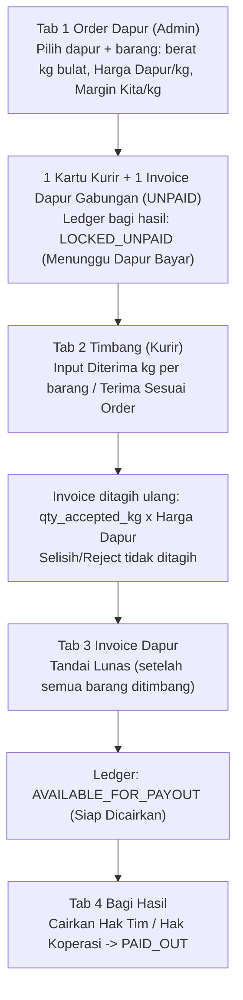

# 01 — Alur Kerja Operasional Harian, Rumus Kalkulasi, & Simulasi Bagi Hasil (Stage 8 — Order-Driven)

Dokumen ini mendefinisikan siklus operasional harian **By Order dari Dapur** untuk menyuplai bahan baku ke **20–30 Dapur Makan Bergizi Gratis (MBG / SPPG)**, rumus finansial presisi tinggi, serta simulasi angka nyata dari Order Dapur hingga Pencairan Bagi Hasil Tim & Koperasi.

> [!IMPORTANT]
> Fase 1 **tidak** memiliki stok batch supplier, HPP per batch, matriks alokasi, maupun settlement/bayar supplier. Satu-satunya dasar keuangan adalah **Harga Dapur / kg** dan **Margin Kita / kg** yang diinput Admin pada setiap Order Dapur.

---

## Diagram Alur Operasional Harian (End-to-End)

---

## Step 1: Input Order Dapur (Admin / Keuangan)

1. Pilih **Dapur Tujuan** (pencarian cepat dari 20–30 dapur).
2. Tambahkan satu atau lebih **baris barang**:
   - **Barang** (mis. `Wortel`) → otomatis mengisi **Harga Dapur/kg** & **Margin Kita/kg** dari master barang (tetap bisa diedit).
   - **Berat Order (`kg` bulat)**, contoh `35`.
   - **Harga Dapur/kg (Rp)**, contoh `14.000` — harga jual ke dapur, sudah termasuk markup.
   - **Margin Kita/kg (Rp)**, contoh `2.000` — dasar bagi hasil Tim & Koperasi (`0 ≤ margin ≤ harga`).
3. Preview: `Total Barang: 2 jenis (60 kg) • Estimasi Tagihan Dapur: Rp 740.000`.
4. **Simpan Order & Kirim ke Daftar Kurir** membuat:
   - 1 `kitchen_deliveries` (`SJ-20261016-DPR01-01`) + baris `kitchen_delivery_items` dengan snapshot harga & margin.
   - 1 `kitchen_invoices` (`INV-20261016-DPR01-01`, `UNPAID`).
   - 2 baris `profit_ledger_entries` per barang (Tim & Koperasi) berstatus `LOCKED_UNPAID`.
   - Order kedua untuk dapur yang sama di hari yang sama (invoice belum lunas) digabung ke order & invoice yang sama.

## Step 2: Pengiriman & Timbang BAST (Kurir)

- Kartu ringkasan **"📦 Total Barang yang Harus Dibawa Kurir"** menjumlahkan berat order per jenis barang.
- 1 kartu = 1 dapur beserta seluruh barang orderannya. Baris belum ditimbang: input kosong (`placeholder="0"`) + tombol `✓ Pas (35 kg)`. Baris tertimbang: `✓ Tertimbang: 35 / 35 kg` + `Ubah`.
- `✓ Terima Sesuai Order (Semua Barang)` hanya mengisi barang yang **belum** ditimbang (tidak menimpa timbangan yang sudah ada).
- Jika `Diterima < Order`: badge `Selisih/Reject -2 kg (Hanya ditagih 33 kg ke Dapur)` + alasan singkat.
- Surat Jalan / BAST & WA BAST **tanpa harga**.

### Rumus (Invariant 1 & 2)
$$\text{qty\_shrinkage\_kg} = \text{qty\_dispatched\_kg} - \text{qty\_accepted\_kg}$$
$$\text{line\_invoice\_amount} = \text{ROUND}(\text{qty\_accepted\_kg} \times \text{kitchen\_unit\_price\_snapshot}, 2)$$
$$\text{line\_margin\_amount} = \text{ROUND}(\text{qty\_accepted\_kg} \times \text{margin\_per\_kg\_snapshot}, 2)$$
$$\text{total\_invoice\_amount} = \sum \text{line\_invoice\_amount}$$

Sebelum barang ditimbang, `qty_accepted_kg` = berat order (estimasi). Tagihan menjadi final setelah semua baris ditimbang.

## Step 3: Invoice Dapur Gabungan & Pelunasan

- Kartu invoice menampilkan setiap baris: `Wortel: 35 kg × Rp 14.000 = Rp 490.000`, total besar, badge `Belum Bayar` / `Lunas` (+ `Menunggu Timbang` bila belum final).
- `✓ Tandai Lunas` hanya aktif bila semua barang sudah ditimbang. Saat `PAID`, trigger atomik mengubah ledger invoice tersebut `LOCKED_UNPAID → AVAILABLE_FOR_PAYOUT`.
- Order yang sudah lunas terkunci (tidak bisa ditimbang ulang, diubah, atau dihapus).

## Step 4: Bagi Hasil (Cash Basis)

$$\text{Total Bagi Hasil} = \sum \text{ROUND}(\text{qty\_accepted\_kg} \times \text{margin\_per\_kg\_snapshot}, 2)$$
$$\text{Hak Koperasi} = \text{ROUND}(\text{Total} \times \tfrac{\text{share\_coop\_pct}}{100}, 2), \quad \text{Hak Tim} = \text{Total} - \text{Hak Koperasi}$$

- **Menunggu Dapur Bayar** (`LOCKED_UNPAID`): dari invoice belum lunas.
- **Siap Dicairkan** (`AVAILABLE_FOR_PAYOUT`): dari invoice lunas → tombol `Cairkan Hak Tim` / `Cairkan Hak Koperasi` membuat `profit_payout_batches` dan mengubah ledger menjadi `PAID_OUT`.

---

## Simulasi Angka Nyata (Seed 16 Oktober 2026, Tim 60% : Koperasi 40%)

| Barang | Harga Dapur / kg | Margin Kita / kg |
| :--- | ---: | ---: |
| Wortel | Rp 14.000 | Rp 2.000 |
| Kubis | Rp 10.000 | Rp 1.500 |
| Daging Ayam Fillet | Rp 40.000 | Rp 4.000 |
| Telur Ayam | Rp 30.500 | Rp 3.000 |
| Beras | Rp 15.000 | Rp 1.500 |

### Tabel 1: Order, Timbang BAST, & Invoice Dapur

| Dapur | Barang (Order → Diterima) | Status Order | Tagihan Dapur | Status Invoice |
| :--- | :--- | :--- | ---: | :--- |
| **DPR-01** | Wortel `35 → 35 kg`, Kubis `25 → 25 kg` | Selesai BAST | Rp 740.000 | **Lunas** |
| **DPR-02** | Daging Ayam `50 → 49 kg` (susut `-1 kg`), Telur `20 → 20 kg` | Selesai BAST | Rp 2.570.000 | **Lunas** |
| **DPR-03** | Wortel `35 → 33 kg` (reject `-2 kg`), Beras `50 → 50 kg` | Selesai BAST | Rp 1.212.000 | Belum Bayar |
| **DPR-04** | Wortel `35 kg`, Kubis `50 kg`, Daging Ayam `50 kg` | Menunggu Kurir | Rp 2.990.000 (estimasi) | Belum Bayar |
| **DPR-05** | Daging Ayam `50 → 50 kg`, Telur `25 kg` (belum) | Sebagian Tertimbang | Rp 2.762.500 (estimasi) | Belum Bayar |
| **TOTAL** | | | **Belum Dibayar Rp 6.964.500 • Lunas Rp 3.310.000** | |

**Total Barang yang Harus Dibawa Kurir:** Wortel `105 kg` • Kubis `75 kg` • Daging Ayam `150 kg` • Telur `45 kg` • Beras `50 kg`.

Contoh DPR-03: Wortel dikirim `35 kg`, diterima `33 kg` → ditagih `33 × Rp 14.000 = Rp 462.000` (bukan Rp 490.000) + Beras `50 × Rp 15.000 = Rp 750.000` = **Rp 1.212.000**.

### Tabel 2: Buku Besar Bagi Hasil

| Dapur | Total Bagi Hasil (Σ diterima × margin) | Hak Tim (60%) | Hak Koperasi (40%) | Status |
| :--- | ---: | ---: | ---: | :--- |
| **DPR-01** | 35×2.000 + 25×1.500 = Rp 107.500 | Rp 64.500 | Rp 43.000 | **Siap Dicairkan** |
| **DPR-02** | 49×4.000 + 20×3.000 = Rp 256.000 | Rp 153.600 | Rp 102.400 | **Siap Dicairkan** |
| **DPR-03** | 33×2.000 + 50×1.500 = Rp 141.000 | Rp 84.600 | Rp 56.400 | Menunggu Dapur Bayar |
| **DPR-04** | 35×2.000 + 50×1.500 + 50×4.000 = Rp 345.000 (estimasi) | Rp 207.000 | Rp 138.000 | Menunggu Dapur Bayar |
| **DPR-05** | 50×4.000 + 25×3.000 = Rp 275.000 (estimasi) | Rp 165.000 | Rp 110.000 | Menunggu Dapur Bayar |

- **Siap Dicairkan:** Tim **Rp 218.100** • Koperasi **Rp 145.400** (total Rp 363.500).
- **Menunggu Dapur Bayar:** total **Rp 761.000** (berubah mengikuti hasil timbang sampai invoice lunas).
