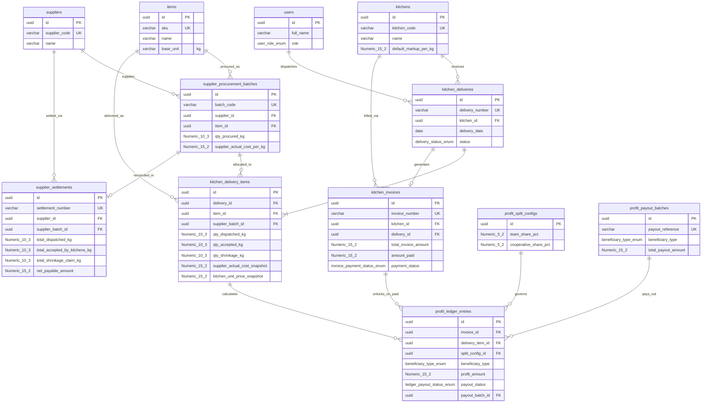

# 02 — Skema Database PostgreSQL/Supabase, Trigger Ledger, & Kebijakan RLS

> [!IMPORTANT]
> **Stage 8 — Order-Driven Flow (Fase 1).** Skema di bawah adalah baseline awal. Migration `supabase/migrations/0004_order_driven_flow.sql` menggantikan bagian supplier:
> - `supplier_procurement_batches` & `supplier_settlements` **dihapus**; `kitchen_delivery_items` tidak lagi memiliki `supplier_batch_id` / `supplier_actual_cost_snapshot`.
> - `kitchen_delivery_items` menyimpan `kitchen_unit_price_snapshot` + `margin_per_kg_snapshot` (0 ≤ margin ≤ harga), kolom generated `line_invoice_amount = ROUND(qty_accepted_kg × harga, 2)` & `line_margin_amount = ROUND(qty_accepted_kg × margin, 2)`, serta `weighed_at`.
> - `items` memiliki `default_kitchen_price_per_kg` & `default_margin_per_kg`.
> - Trigger: total invoice = Σ `line_invoice_amount`; invoice tidak bisa `PAID` sebelum semua baris ditimbang; snapshot harga/margin immutable; baris order terkunci setelah invoice `PAID`.
> - `v_safe_delivery_items_bast` dibangun ulang tanpa `batch_code`, dengan `is_weighed` & `is_locked` (tetap tanpa kolom harga — Invariant 5).
> - Trigger ledger cash-basis (`LOCKED_UNPAID → AVAILABLE_FOR_PAYOUT` saat `PAID`) tetap berlaku; `unit_markup_snapshot` kini berisi margin per kg.

Dokumen ini mendefinisikan skema database relasional (`PostgreSQL 15+ / Supabase`) yang menegakkan **5 Invariant Bisnis Utama** di level *database engine* melalui tipe data `NUMERIC`, *check constraints*, *stored triggers*, dan *Row-Level Security (RLS)*.

## 1. Entity-Relationship Diagram (Mermaid ERD)



## 2. DDL SQL Lengkap (PostgreSQL / Supabase)

```sql
CREATE EXTENSION IF NOT EXISTS "pgcrypto";

CREATE TYPE user_role_enum AS ENUM ('FIELD_TEAM', 'COOPERATIVE_VIEWER', 'FINANCE', 'OWNER_ADMIN');
CREATE TYPE delivery_status_enum AS ENUM ('ALLOCATED', 'IN_TRANSIT', 'BAST_VERIFIED', 'INVOICED');
CREATE TYPE invoice_payment_status_enum AS ENUM ('DRAFT', 'ISSUED', 'UNPAID', 'PARTIALLY_PAID', 'PAID');
CREATE TYPE settlement_status_enum AS ENUM ('PENDING_BAST', 'READY_TO_PAY', 'PAID');
CREATE TYPE beneficiary_type_enum AS ENUM ('TEAM', 'COOPERATIVE');
CREATE TYPE ledger_payout_status_enum AS ENUM ('LOCKED_UNPAID', 'AVAILABLE_FOR_PAYOUT', 'PAID_OUT');

-- 1. USERS
CREATE TABLE public.users (
    id UUID PRIMARY KEY REFERENCES auth.users(id) ON DELETE CASCADE,
    full_name VARCHAR(120) NOT NULL,
    email VARCHAR(150) UNIQUE NOT NULL,
    phone VARCHAR(30),
    role user_role_enum NOT NULL DEFAULT 'FIELD_TEAM',
    is_active BOOLEAN NOT NULL DEFAULT TRUE,
    created_at TIMESTAMPTZ NOT NULL DEFAULT NOW(),
    updated_at TIMESTAMPTZ NOT NULL DEFAULT NOW()
);

-- 2. KITCHENS (20-30 Dapur MBG)
CREATE TABLE public.kitchens (
    id UUID PRIMARY KEY DEFAULT gen_random_uuid(),
    kitchen_code VARCHAR(30) UNIQUE NOT NULL,
    name VARCHAR(150) NOT NULL,
    address TEXT NOT NULL,
    pic_name VARCHAR(120) NOT NULL,
    pic_phone VARCHAR(30) NOT NULL,
    default_markup_per_kg NUMERIC(15,2) NOT NULL DEFAULT 0.00 CHECK (default_markup_per_kg >= 0),
    is_active BOOLEAN NOT NULL DEFAULT TRUE,
    created_at TIMESTAMPTZ NOT NULL DEFAULT NOW()
);

-- 3. SUPPLIERS
CREATE TABLE public.suppliers (
    id UUID PRIMARY KEY DEFAULT gen_random_uuid(),
    supplier_code VARCHAR(30) UNIQUE NOT NULL,
    name VARCHAR(150) NOT NULL,
    contact_person VARCHAR(120),
    phone VARCHAR(30),
    bank_name VARCHAR(60),
    bank_account_number VARCHAR(60),
    bank_account_holder VARCHAR(120),
    is_active BOOLEAN NOT NULL DEFAULT TRUE,
    created_at TIMESTAMPTZ NOT NULL DEFAULT NOW()
);

-- 4. ITEMS (Satuan dasar wajib 'kg' - Invariant 1)
CREATE TABLE public.items (
    id UUID PRIMARY KEY DEFAULT gen_random_uuid(),
    sku VARCHAR(40) UNIQUE NOT NULL,
    name VARCHAR(150) NOT NULL,
    category VARCHAR(60) NOT NULL,
    base_unit VARCHAR(10) NOT NULL DEFAULT 'kg' CHECK (base_unit = 'kg'),
    is_active BOOLEAN NOT NULL DEFAULT TRUE,
    created_at TIMESTAMPTZ NOT NULL DEFAULT NOW()
);

-- 5. SUPPLIER PROCUREMENT BATCHES (Harga aktual per batch - Invariant 3)
CREATE TABLE public.supplier_procurement_batches (
    id UUID PRIMARY KEY DEFAULT gen_random_uuid(),
    batch_code VARCHAR(60) UNIQUE NOT NULL,
    supplier_id UUID NOT NULL REFERENCES public.suppliers(id) ON DELETE RESTRICT,
    item_id UUID NOT NULL REFERENCES public.items(id) ON DELETE RESTRICT,
    procurement_date DATE NOT NULL,
    qty_procured_kg NUMERIC(10,3) NOT NULL CHECK (qty_procured_kg > 0),
    supplier_actual_cost_per_kg NUMERIC(15,2) NOT NULL CHECK (supplier_actual_cost_per_kg > 0),
    notes TEXT,
    created_by UUID REFERENCES public.users(id),
    created_at TIMESTAMPTZ NOT NULL DEFAULT NOW()
);

-- 6. KITCHEN DELIVERIES (Surat Jalan & BAST)
CREATE TABLE public.kitchen_deliveries (
    id UUID PRIMARY KEY DEFAULT gen_random_uuid(),
    delivery_number VARCHAR(60) UNIQUE NOT NULL,
    kitchen_id UUID NOT NULL REFERENCES public.kitchens(id) ON DELETE RESTRICT,
    delivery_date DATE NOT NULL,
    status delivery_status_enum NOT NULL DEFAULT 'ALLOCATED',
    courier_user_id UUID REFERENCES public.users(id),
    bast_signed_by_name VARCHAR(120),
    bast_photo_url TEXT,
    bast_verified_at TIMESTAMPTZ,
    notes TEXT,
    created_at TIMESTAMPTZ NOT NULL DEFAULT NOW(),
    updated_at TIMESTAMPTZ NOT NULL DEFAULT NOW(),
    UNIQUE (kitchen_id, delivery_date, delivery_number)
);

-- 7. KITCHEN DELIVERY ITEMS (Mengikat batch, bobot kirim/terima/susut, & snapshot harga)
CREATE TABLE public.kitchen_delivery_items (
    id UUID PRIMARY KEY DEFAULT gen_random_uuid(),
    delivery_id UUID NOT NULL REFERENCES public.kitchen_deliveries(id) ON DELETE CASCADE,
    item_id UUID NOT NULL REFERENCES public.items(id) ON DELETE RESTRICT,
    supplier_batch_id UUID NOT NULL REFERENCES public.supplier_procurement_batches(id) ON DELETE RESTRICT,
    qty_dispatched_kg NUMERIC(10,3) NOT NULL CHECK (qty_dispatched_kg > 0),
    qty_accepted_kg NUMERIC(10,3) NOT NULL DEFAULT 0.000 CHECK (qty_accepted_kg >= 0 AND qty_accepted_kg <= qty_dispatched_kg),
    qty_shrinkage_kg NUMERIC(10,3) GENERATED ALWAYS AS (qty_dispatched_kg - qty_accepted_kg) STORED,
    supplier_actual_cost_snapshot NUMERIC(15,2) NOT NULL CHECK (supplier_actual_cost_snapshot > 0),
    kitchen_unit_price_snapshot NUMERIC(15,2) NOT NULL CHECK (kitchen_unit_price_snapshot >= supplier_actual_cost_snapshot),
    line_invoice_amount NUMERIC(15,2) GENERATED ALWAYS AS (ROUND(qty_accepted_kg * kitchen_unit_price_snapshot, 2)) STORED,
    line_supplier_payable_amount NUMERIC(15,2) GENERATED ALWAYS AS (ROUND(qty_accepted_kg * supplier_actual_cost_snapshot, 2)) STORED,
    line_supplier_claim_amount NUMERIC(15,2) GENERATED ALWAYS AS (ROUND((qty_dispatched_kg - qty_accepted_kg) * supplier_actual_cost_snapshot, 2)) STORED,
    line_total_markup_amount NUMERIC(15,2) GENERATED ALWAYS AS (ROUND(qty_accepted_kg * (kitchen_unit_price_snapshot - supplier_actual_cost_snapshot), 2)) STORED,
    rejection_reason TEXT,
    created_at TIMESTAMPTZ NOT NULL DEFAULT NOW(),
    updated_at TIMESTAMPTZ NOT NULL DEFAULT NOW()
);

-- 8. KITCHEN INVOICES
CREATE TABLE public.kitchen_invoices (
    id UUID PRIMARY KEY DEFAULT gen_random_uuid(),
    invoice_number VARCHAR(60) UNIQUE NOT NULL,
    kitchen_id UUID NOT NULL REFERENCES public.kitchens(id) ON DELETE RESTRICT,
    delivery_id UUID UNIQUE NOT NULL REFERENCES public.kitchen_deliveries(id) ON DELETE RESTRICT,
    invoice_date DATE NOT NULL,
    due_date DATE NOT NULL,
    total_invoice_amount NUMERIC(15,2) NOT NULL CHECK (total_invoice_amount >= 0),
    amount_paid NUMERIC(15,2) NOT NULL DEFAULT 0.00 CHECK (amount_paid >= 0 AND amount_paid <= total_invoice_amount),
    payment_status invoice_payment_status_enum NOT NULL DEFAULT 'UNPAID',
    payment_proof_url TEXT,
    paid_at TIMESTAMPTZ,
    verified_by UUID REFERENCES public.users(id),
    created_at TIMESTAMPTZ NOT NULL DEFAULT NOW(),
    updated_at TIMESTAMPTZ NOT NULL DEFAULT NOW(),
    CONSTRAINT chk_invoice_fully_paid CHECK ((payment_status <> 'PAID') OR (amount_paid = total_invoice_amount AND total_invoice_amount > 0))
);

-- 9. SUPPLIER SETTLEMENTS (Tagihan bersih supplier setelah dipotong susut dapur - Invariant 2)
CREATE TABLE public.supplier_settlements (
    id UUID PRIMARY KEY DEFAULT gen_random_uuid(),
    settlement_number VARCHAR(60) UNIQUE NOT NULL,
    supplier_id UUID NOT NULL REFERENCES public.suppliers(id) ON DELETE RESTRICT,
    supplier_batch_id UUID UNIQUE NOT NULL REFERENCES public.supplier_procurement_batches(id) ON DELETE RESTRICT,
    total_dispatched_kg NUMERIC(10,3) NOT NULL CHECK (total_dispatched_kg >= 0),
    total_accepted_by_kitchens_kg NUMERIC(10,3) NOT NULL CHECK (total_accepted_by_kitchens_kg >= 0),
    total_shrinkage_claim_kg NUMERIC(10,3) GENERATED ALWAYS AS (total_dispatched_kg - total_accepted_by_kitchens_kg) STORED,
    supplier_actual_cost_per_kg NUMERIC(15,2) NOT NULL CHECK (supplier_actual_cost_per_kg > 0),
    gross_payable_amount NUMERIC(15,2) GENERATED ALWAYS AS (ROUND(total_dispatched_kg * supplier_actual_cost_per_kg, 2)) STORED,
    shrinkage_claim_deduction_amount NUMERIC(15,2) GENERATED ALWAYS AS (ROUND((total_dispatched_kg - total_accepted_by_kitchens_kg) * supplier_actual_cost_per_kg, 2)) STORED,
    net_payable_amount NUMERIC(15,2) GENERATED ALWAYS AS (ROUND(total_accepted_by_kitchens_kg * supplier_actual_cost_per_kg, 2)) STORED,
    status settlement_status_enum NOT NULL DEFAULT 'PENDING_BAST',
    payment_proof_url TEXT,
    paid_at TIMESTAMPTZ,
    created_at TIMESTAMPTZ NOT NULL DEFAULT NOW(),
    updated_at TIMESTAMPTZ NOT NULL DEFAULT NOW()
);

-- 10. PROFIT SPLIT CONFIGS
CREATE TABLE public.profit_split_configs (
    id UUID PRIMARY KEY DEFAULT gen_random_uuid(),
    config_name VARCHAR(100) NOT NULL,
    team_share_pct NUMERIC(5,2) NOT NULL CHECK (team_share_pct >= 0 AND team_share_pct <= 100),
    cooperative_share_pct NUMERIC(5,2) NOT NULL CHECK (cooperative_share_pct >= 0 AND cooperative_share_pct <= 100),
    is_active BOOLEAN NOT NULL DEFAULT TRUE,
    effective_from DATE NOT NULL DEFAULT CURRENT_DATE,
    created_at TIMESTAMPTZ NOT NULL DEFAULT NOW(),
    CONSTRAINT chk_total_split_100_pct CHECK (team_share_pct + cooperative_share_pct = 100.00)
);

-- 11. PROFIT PAYOUT BATCHES
CREATE TABLE public.profit_payout_batches (
    id UUID PRIMARY KEY DEFAULT gen_random_uuid(),
    payout_reference VARCHAR(60) UNIQUE NOT NULL,
    beneficiary_type beneficiary_type_enum NOT NULL,
    total_payout_amount NUMERIC(15,2) NOT NULL CHECK (total_payout_amount > 0),
    transfer_proof_url TEXT NOT NULL,
    notes TEXT,
    disbursed_by UUID NOT NULL REFERENCES public.users(id),
    disbursed_at TIMESTAMPTZ NOT NULL DEFAULT NOW(),
    created_at TIMESTAMPTZ NOT NULL DEFAULT NOW()
);

-- 12. PROFIT LEDGER ENTRIES (Status LOCKED_UNPAID vs AVAILABLE_FOR_PAYOUT vs PAID_OUT)
CREATE TABLE public.profit_ledger_entries (
    id UUID PRIMARY KEY DEFAULT gen_random_uuid(),
    invoice_id UUID NOT NULL REFERENCES public.kitchen_invoices(id) ON DELETE RESTRICT,
    delivery_item_id UUID NOT NULL REFERENCES public.kitchen_delivery_items(id) ON DELETE RESTRICT,
    split_config_id UUID NOT NULL REFERENCES public.profit_split_configs(id) ON DELETE RESTRICT,
    beneficiary_type beneficiary_type_enum NOT NULL,
    qty_accepted_kg NUMERIC(10,3) NOT NULL CHECK (qty_accepted_kg >= 0),
    unit_markup_snapshot NUMERIC(15,2) NOT NULL CHECK (unit_markup_snapshot >= 0),
    share_pct_snapshot NUMERIC(5,2) NOT NULL CHECK (share_pct_snapshot >= 0 AND share_pct_snapshot <= 100),
    profit_amount NUMERIC(15,2) NOT NULL CHECK (profit_amount >= 0),
    payout_status ledger_payout_status_enum NOT NULL DEFAULT 'LOCKED_UNPAID',
    payout_batch_id UUID REFERENCES public.profit_payout_batches(id) ON DELETE RESTRICT,
    unlocked_at TIMESTAMPTZ,
    paid_out_at TIMESTAMPTZ,
    created_at TIMESTAMPTZ NOT NULL DEFAULT NOW(),
    updated_at TIMESTAMPTZ NOT NULL DEFAULT NOW(),
    UNIQUE (delivery_item_id, beneficiary_type),
    CONSTRAINT chk_paid_out_requires_batch CHECK ((payout_status <> 'PAID_OUT') OR (payout_batch_id IS NOT NULL AND paid_out_at IS NOT NULL))
);
```

## 3. Database Triggers & Stored Functions (Penegakan Invariant 3 & 4)

```sql
-- 3.1 Trigger Snapshot Harga Otomatis dari Batch Supplier (Invariant 3)
CREATE OR REPLACE FUNCTION public.fn_populate_supplier_cost_snapshot()
RETURNS TRIGGER LANGUAGE plpgsql SECURITY DEFINER AS $$
DECLARE
    v_batch_cost NUMERIC(15,2);
    v_batch_item UUID;
BEGIN
    SELECT supplier_actual_cost_per_kg, item_id INTO v_batch_cost, v_batch_item
      FROM public.supplier_procurement_batches WHERE id = NEW.supplier_batch_id;
    IF NOT FOUND THEN RAISE EXCEPTION 'Batch supplier % tidak ditemukan', NEW.supplier_batch_id; END IF;
    IF v_batch_item <> NEW.item_id THEN RAISE EXCEPTION 'Item tidak cocok dengan Batch Supplier'; END IF;
    NEW.supplier_actual_cost_snapshot := v_batch_cost;
    IF NEW.kitchen_unit_price_snapshot < NEW.supplier_actual_cost_snapshot THEN
        RAISE EXCEPTION 'Harga dapur tidak boleh lebih rendah dari harga aktual supplier';
    END IF;
    RETURN NEW;
END;
$$;

CREATE TRIGGER trg_before_insert_delivery_item_snapshot
BEFORE INSERT ON public.kitchen_delivery_items
FOR EACH ROW EXECUTE FUNCTION public.fn_populate_supplier_cost_snapshot();

-- 3.2 Trigger Otomatis: Invoice PAID -> Ledger AVAILABLE_FOR_PAYOUT (Invariant 4)
CREATE OR REPLACE FUNCTION public.fn_sync_invoice_payment_to_profit_ledger()
RETURNS TRIGGER LANGUAGE plpgsql SECURITY DEFINER AS $$
BEGIN
    IF NEW.payment_status = 'PAID' AND (OLD.payment_status IS DISTINCT FROM 'PAID') THEN
        IF NEW.amount_paid < NEW.total_invoice_amount THEN
            RAISE EXCEPTION 'Invariant 4 Violation: Invoice % belum lunas penuh', NEW.invoice_number;
        END IF;
        NEW.paid_at := COALESCE(NEW.paid_at, NOW());
        UPDATE public.profit_ledger_entries
           SET payout_status = 'AVAILABLE_FOR_PAYOUT', unlocked_at = NOW(), updated_at = NOW()
         WHERE invoice_id = NEW.id AND payout_status = 'LOCKED_UNPAID';

    ELSIF OLD.payment_status = 'PAID' AND NEW.payment_status <> 'PAID' THEN
        IF EXISTS (SELECT 1 FROM public.profit_ledger_entries WHERE invoice_id = NEW.id AND payout_status = 'PAID_OUT') THEN
            RAISE EXCEPTION 'Invariant 4 Violation: Bagi hasil Invoice % sudah PAID_OUT', NEW.invoice_number;
        END IF;
        UPDATE public.profit_ledger_entries
           SET payout_status = 'LOCKED_UNPAID', unlocked_at = NULL, updated_at = NOW()
         WHERE invoice_id = NEW.id AND payout_status = 'AVAILABLE_FOR_PAYOUT';
    END IF;
    NEW.updated_at := NOW();
    RETURN NEW;
END;
$$;

CREATE TRIGGER trg_sync_invoice_paid_to_profit_ledger
BEFORE UPDATE OF payment_status, amount_paid ON public.kitchen_invoices
FOR EACH ROW EXECUTE FUNCTION public.fn_sync_invoice_payment_to_profit_ledger();

-- 3.3 Trigger Guard: Cegah Pencairan Jika Invoice Belum PAID
CREATE OR REPLACE FUNCTION public.fn_guard_profit_ledger_transition()
RETURNS TRIGGER LANGUAGE plpgsql SECURITY DEFINER AS $$
DECLARE v_invoice_status invoice_payment_status_enum;
BEGIN
    SELECT payment_status INTO v_invoice_status FROM public.kitchen_invoices WHERE id = NEW.invoice_id;
    IF NEW.payout_status IN ('AVAILABLE_FOR_PAYOUT', 'PAID_OUT') AND v_invoice_status <> 'PAID' THEN
        RAISE EXCEPTION 'Invariant 4 Violation: Invoice % masih berstatus %', NEW.invoice_id, v_invoice_status;
    END IF;
    IF TG_OP = 'UPDATE' AND OLD.payout_status = 'LOCKED_UNPAID' AND NEW.payout_status = 'PAID_OUT' THEN
        RAISE EXCEPTION 'Invariant 4 Violation: Wajib melalui AVAILABLE_FOR_PAYOUT sebelum PAID_OUT';
    END IF;
    RETURN NEW;
END;
$$;

CREATE TRIGGER trg_guard_profit_ledger_transition
BEFORE INSERT OR UPDATE ON public.profit_ledger_entries
FOR EACH ROW EXECUTE FUNCTION public.fn_guard_profit_ledger_transition();
```

## 4. Row-Level Security (RLS) & Proteksi Harga Modal (Invariant 5)

```sql
CREATE OR REPLACE FUNCTION public.fn_current_user_role()
RETURNS user_role_enum LANGUAGE sql STABLE SECURITY DEFINER AS $$
    SELECT role FROM public.users WHERE id = auth.uid() AND is_active = TRUE;
$$;

ALTER TABLE public.supplier_procurement_batches ENABLE ROW LEVEL SECURITY;
ALTER TABLE public.kitchen_deliveries ENABLE ROW LEVEL SECURITY;
ALTER TABLE public.kitchen_delivery_items ENABLE ROW LEVEL SECURITY;
ALTER TABLE public.kitchen_invoices ENABLE ROW LEVEL SECURITY;
ALTER TABLE public.supplier_settlements ENABLE ROW LEVEL SECURITY;
ALTER TABLE public.profit_ledger_entries ENABLE ROW LEVEL SECURITY;
ALTER TABLE public.profit_payout_batches ENABLE ROW LEVEL SECURITY;

-- OWNER_ADMIN & FINANCE: Full Access
CREATE POLICY pol_admin_finance_batches ON public.supplier_procurement_batches FOR ALL USING (public.fn_current_user_role() IN ('OWNER_ADMIN', 'FINANCE'));
CREATE POLICY pol_admin_finance_delivery_items ON public.kitchen_delivery_items FOR ALL USING (public.fn_current_user_role() IN ('OWNER_ADMIN', 'FINANCE'));
CREATE POLICY pol_admin_finance_invoices ON public.kitchen_invoices FOR ALL USING (public.fn_current_user_role() IN ('OWNER_ADMIN', 'FINANCE'));
CREATE POLICY pol_admin_finance_settlements ON public.supplier_settlements FOR ALL USING (public.fn_current_user_role() IN ('OWNER_ADMIN', 'FINANCE'));
CREATE POLICY pol_admin_finance_ledger ON public.profit_ledger_entries FOR ALL USING (public.fn_current_user_role() IN ('OWNER_ADMIN', 'FINANCE'));

-- COOPERATIVE_VIEWER: Lihat Invoice Dapur & Buku Besar Bagi Hasil Koperasi
CREATE POLICY pol_coop_view_invoices ON public.kitchen_invoices FOR SELECT USING (public.fn_current_user_role() = 'COOPERATIVE_VIEWER');
CREATE POLICY pol_coop_view_ledger ON public.profit_ledger_entries FOR SELECT USING (public.fn_current_user_role() = 'COOPERATIVE_VIEWER' AND beneficiary_type = 'COOPERATIVE');

-- FIELD_TEAM: Hanya bisa baca header pengiriman & akses kuantitas via Security-Barrier View + RPC (Tanpa Harga/HPP)
CREATE POLICY pol_all_roles_deliveries ON public.kitchen_deliveries FOR SELECT USING (public.fn_current_user_role() IN ('FIELD_TEAM', 'COOPERATIVE_VIEWER', 'FINANCE', 'OWNER_ADMIN'));

CREATE OR REPLACE VIEW public.v_safe_delivery_items_bast WITH (security_barrier = true) AS
SELECT kdi.id AS delivery_item_id, kdi.delivery_id, kd.delivery_number, kd.delivery_date,
       kd.kitchen_id, k.name AS kitchen_name, kdi.item_id, i.name AS item_name, i.base_unit,
       kdi.qty_dispatched_kg, kdi.qty_accepted_kg, kdi.qty_shrinkage_kg, kdi.rejection_reason
FROM public.kitchen_delivery_items kdi
JOIN public.kitchen_deliveries kd ON kd.id = kdi.delivery_id
JOIN public.kitchens k ON k.id = kd.kitchen_id
JOIN public.items i ON i.id = kdi.item_id;
```
